# Sistema de Gestión de Inventario

Aplicación web para gestionar productos y registrar movimientos de inventario (compras y ventas), construida con una arquitectura de microservicios en **.NET 10**, un frontend en **Angular 22** y **SQL Server**.

Permite crear, editar, consultar y eliminar productos; registrar compras y ventas con validación de stock; y consultar el historial de transacciones de cada producto con filtros dinámicos.

## Contenido

- [Arquitectura](#arquitectura)
- [Tecnologías](#tecnologías)
- [Estructura del repositorio](#estructura-del-repositorio)
- [Requisitos](#requisitos)
- [Base de datos](#base-de-datos)
- [Ejecución del backend](#ejecución-del-backend)
- [Ejecución del frontend](#ejecución-del-frontend)
- [API](#api)
- [Reglas de negocio](#reglas-de-negocio)
- [Evidencias](#evidencias)

## Arquitectura

```
                 ┌──────────────────────────┐
                 │  Frontend Angular (4200) │
                 └─────┬──────────────┬─────┘
                       │ REST         │ REST
                       ▼              ▼
          ┌─────────────────┐   ┌──────────────────────┐
          │  Products.Api   │◄──│  Transactions.Api    │
          │     (5001)      │   │       (5002)         │
          └────────┬────────┘   └──────────┬───────────┘
                   │  REST síncrono:        │
                   │  validar y ajustar     │
                   │  stock                 │
                   ▼                        ▼
       InventoryProductsDb       InventoryTransactionsDb
```

- **Database per Service**: cada microservicio es dueño exclusivo de su base de datos. Ninguno accede a las tablas del otro.
- **Comunicación síncrona por REST**: Transactions.Api llama a Products.Api para validar y ajustar el stock. La dependencia va en una sola dirección.
- **Capas en cada servicio**: `Controller → Service → Repository → DbContext`.
  - Los controllers solo manejan HTTP.
  - Los servicios contienen las reglas de negocio.
  - Los repositorios, el acceso a datos.

## Tecnologías

| Capa | Tecnología |
|---|---|
| Backend | .NET 10, ASP.NET Core Web API, Entity Framework Core 10 |
| Base de datos | SQL Server |
| Frontend | Angular 22 (standalone, signals, zoneless), Angular Material 22 |
| Documentación de la API | OpenAPI + Swagger UI |

## Estructura del repositorio

```
inventory-management/
├── database.sql                  # Script de creación de las bases de datos
├── backend/
│   ├── InventoryManagement.slnx  # Solución con ambos microservicios
│   ├── Products.Api/             # Microservicio de productos
│   └── Transactions.Api/         # Microservicio de transacciones
├── frontend/                     # Aplicación Angular
└── docs/screenshots/             # Capturas de la aplicación
```

Cada microservicio se organiza en:

| Carpeta | Contenido |
|---|---|
| `Controllers` | Endpoints REST |
| `Services` | Lógica de negocio |
| `Repositories` | Consultas con EF Core |
| `Entities` | Clases que mapean las tablas |
| `Dtos` | Contratos de entrada y salida de la API |
| `Data` | DbContext y configuración de las tablas |
| `Middleware` | Manejo global de errores |
| `Clients` | Cliente HTTP hacia Products.Api (solo en Transactions.Api) |

## Requisitos

| Herramienta | Versión |
|---|---|
| [.NET SDK](https://dotnet.microsoft.com/download) | 10.0 o superior |
| SQL Server | 2019 o superior (Express o Developer) |
| [Node.js](https://nodejs.org/) | 22.22 o superior, o 24 LTS |
| Angular CLI | 22 (`npm install -g @angular/cli`) |
| SQL Server Management Studio | Opcional, para ejecutar el script |

Puertos utilizados: **5001** (Products.Api), **5002** (Transactions.Api) y **4200** (frontend).

## Base de datos

El script [`database.sql`](database.sql), en la raíz del repositorio, crea las dos bases de datos con sus tablas, restricciones, índices y las categorías iniciales.

| Base de datos | Tablas |
|---|---|
| `InventoryProductsDb` | `Categories`, `Products` |
| `InventoryTransactionsDb` | `Transactions` |

Para crearlas:

1. Abrir SQL Server Management Studio y conectarse al servidor local.
2. Abrir `database.sql` y ejecutarlo (F5).

O desde la línea de comandos:

```powershell
sqlcmd -S localhost -E -i database.sql
```

## Ejecución del backend

### 1. Configurar la conexión

Por defecto, ambos servicios se conectan a `localhost` con autenticación de Windows. Si se usa otro servidor o autenticación de SQL Server, hay que ajustar `ConnectionStrings` en el `appsettings.json` de cada proyecto:

```json
"ConnectionStrings": {
  "ProductsDb": "Server=localhost;Database=InventoryProductsDb;User Id=sa;Password=TuPassword;TrustServerCertificate=True"
}
```

En `Transactions.Api`, la clave es `TransactionsDb`, y la URL de Products.Api se configura en `Services:ProductsApi`.

### 2. Ejecutar

**Opción A: Visual Studio**

1. Abrir `backend/InventoryManagement.slnx`.
2. Seleccionar el perfil de inicio que arranca ambos proyectos (configurado como "Varios proyectos de inicio").
3. Ejecutar con **Ctrl + F5**.

**Opción B: línea de comandos** (una terminal para cada servicio, iniciando primero Products.Api)

```powershell
cd backend
dotnet run --project Products.Api --launch-profile http
```

```powershell
cd backend
dotnet run --project Transactions.Api --launch-profile http
```

### 3. Verificar

| Servicio | Swagger UI | Prueba rápida |
|---|---|---|
| Products.Api | http://localhost:5001/swagger | http://localhost:5001/api/categories |
| Transactions.Api | http://localhost:5002/swagger | http://localhost:5002/api/transactions |

Cada proyecto incluye además un archivo `.http` (`Products.Api.http` y `Transactions.Api.http`) con peticiones de prueba listas para ejecutar desde Visual Studio.

## Ejecución del frontend

Con el backend en ejecución:

```powershell
cd frontend
npm install
ng serve
```

Abrir **http://localhost:4200**.

Las URLs de las APIs se configuran en `frontend/src/environments/environment.ts`.

Para ejecutar las pruebas unitarias:

```powershell
ng test
```

## API

### Products.Api — `http://localhost:5001`

| Método | Ruta | Descripción |
|---|---|---|
| GET | `/api/products` | Listado paginado. Filtros: `name`, `categoryId`, `minPrice`, `maxPrice`, `page`, `pageSize` |
| GET | `/api/products/{id}` | Detalle de un producto (`?includeInactive=true` incluye eliminados) |
| POST | `/api/products` | Crear producto |
| PUT | `/api/products/{id}` | Editar producto |
| DELETE | `/api/products/{id}` | Eliminar producto (eliminado lógico) |
| PATCH | `/api/products/{id}/stock` | Ajustar stock (uso interno de Transactions.Api) |
| GET | `/api/categories` | Listado de categorías |

### Transactions.Api — `http://localhost:5002`

| Método | Ruta | Descripción |
|---|---|---|
| GET | `/api/transactions` | Listado paginado. Filtros: `productId`, `type`, `from`, `to`, `page`, `pageSize` |
| GET | `/api/transactions/history/{productId}` | Historial de un producto, con su nombre y stock actual |
| GET | `/api/transactions/{id}` | Detalle de una transacción |
| POST | `/api/transactions` | Registrar compra o venta |
| PUT | `/api/transactions/{id}` | Editar transacción (recalcula el stock) |
| DELETE | `/api/transactions/{id}` | Eliminar transacción (revierte su efecto en el stock) |

Los errores se devuelven en formato **ProblemDetails** (RFC 9457):

| Código | Significado |
|---|---|
| 400 | Datos inválidos |
| 404 | Recurso no encontrado |
| 409 | Stock insuficiente o conflicto de concurrencia |
| 503 | Products.Api no disponible |

## Reglas de negocio

- **Validación de stock**: una venta no puede superar el stock disponible. El frontend lo advierte antes de enviar, y el backend lo garantiza con un `UPDATE` atómico (`WHERE Stock + delta >= 0`) que evita condiciones de carrera entre ventas simultáneas.
- **Ajuste automático de stock**: cada transacción tiene un efecto sobre el stock (+cantidad en compras, −cantidad en ventas).
  - Al **crear**, se aplica ese efecto.
  - Al **editar**, se aplica la diferencia: efecto nuevo − efecto anterior.
  - Al **eliminar**, se revierte.
- **Compensación entre servicios**: no existe una transacción SQL que abarque dos bases de datos. Por eso, primero se ajusta el stock en Products.Api y luego se guarda la transacción. Si el guardado falla, se aplica el ajuste inverso para dejar el stock como estaba.
- **Eliminado lógico de productos**: un producto eliminado deja de estar disponible para operar, pero su historial de transacciones se conserva y se puede consultar en modo de solo lectura.
- **Integridad del historial**:
  - Cada transacción guarda el precio unitario del momento.
  - El total lo calcula la base de datos (columna calculada).
  - El producto de una transacción no se puede cambiar al editarla.

## Evidencias

### Listado de productos con paginación
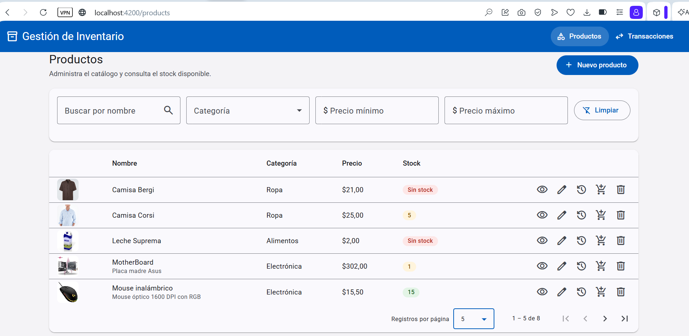

### Filtros dinámicos de productos
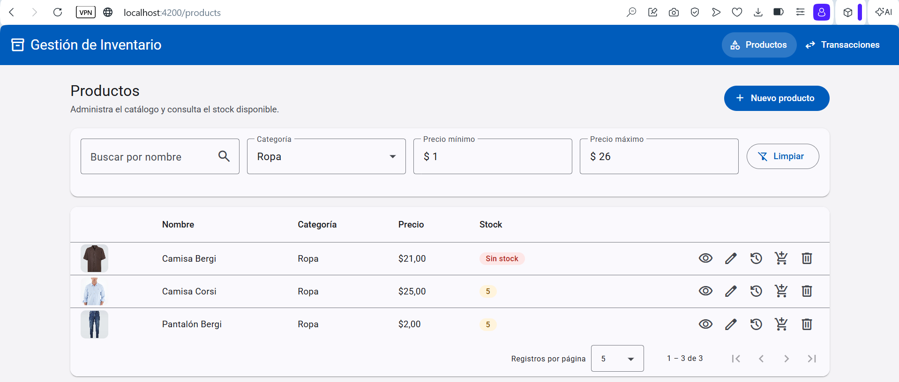

### Validaciones en el formulario de producto
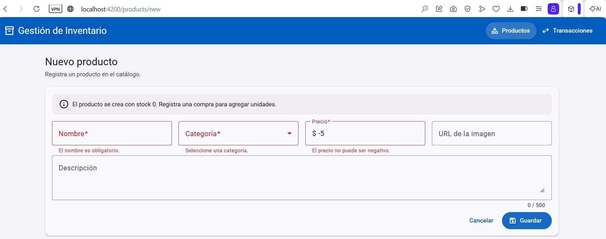

### Creación de productos
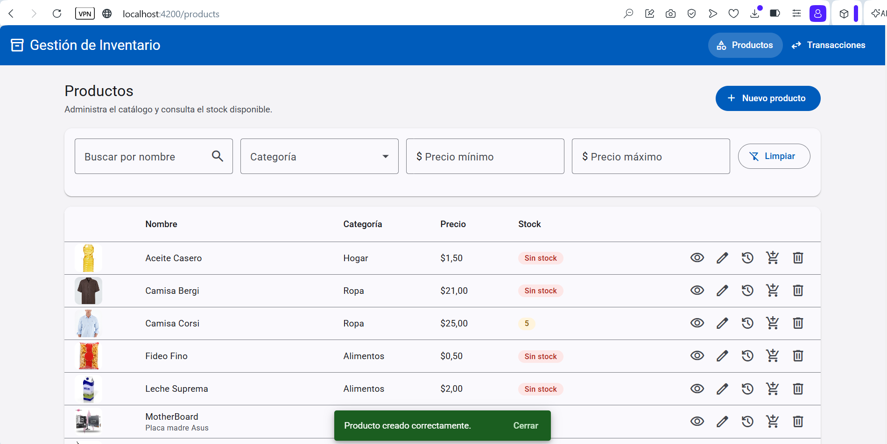

### Edición de productos
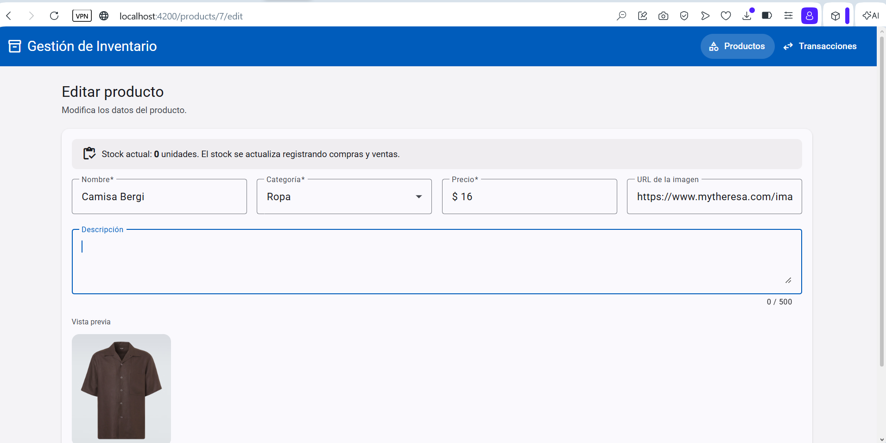

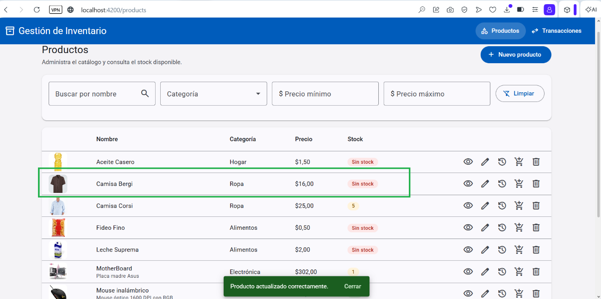

### Consulta de información de un producto
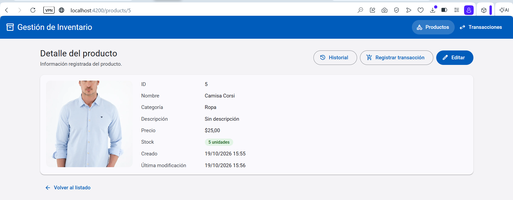

### Creación de transacciones
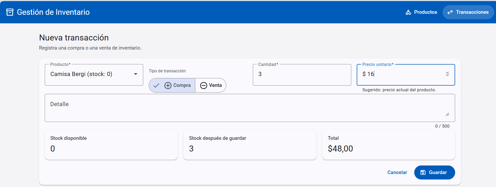

### Validación de stock disponible
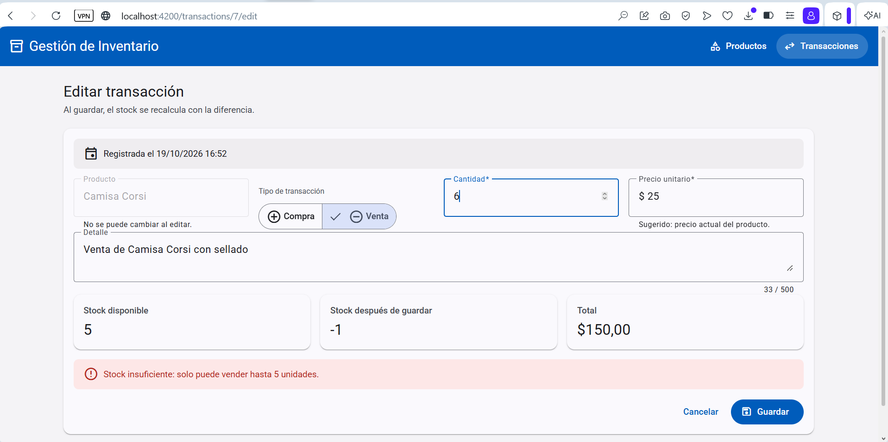

### Edición de transacciones
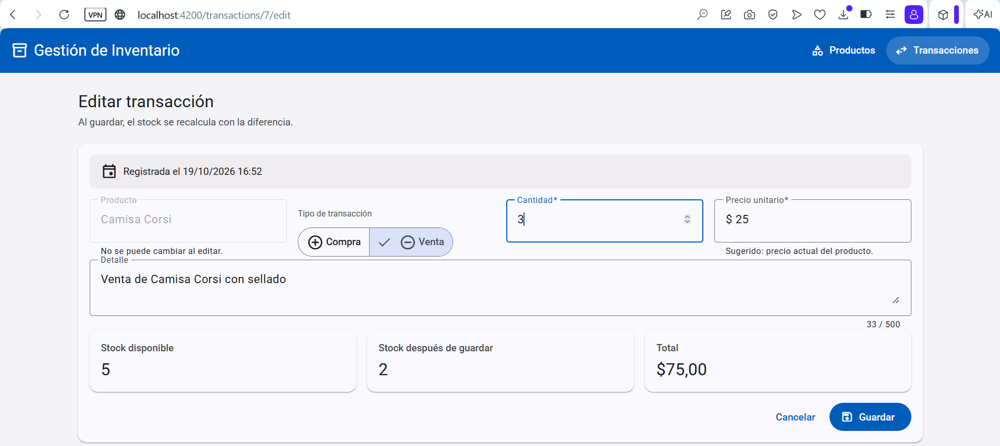

### Listado de transacciones con paginación
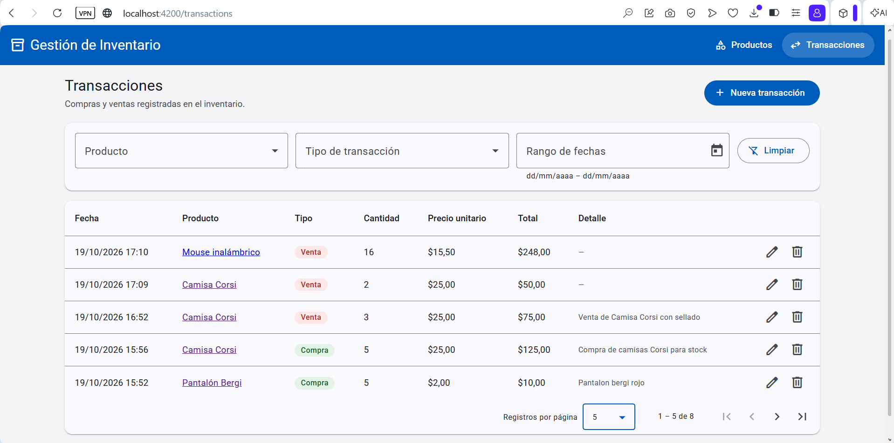

### Historial de transacciones por producto con filtros
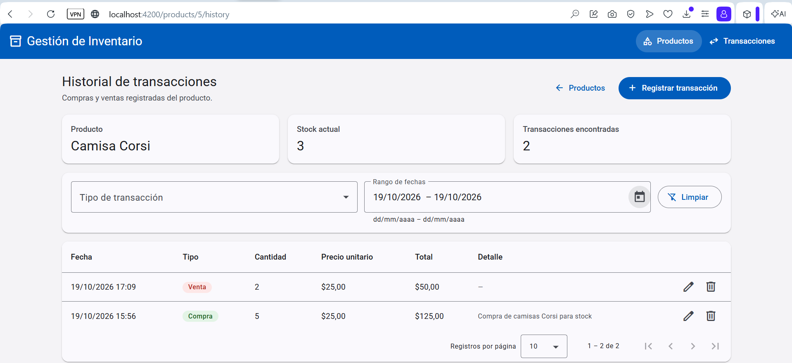

### Eliminación de transacciones
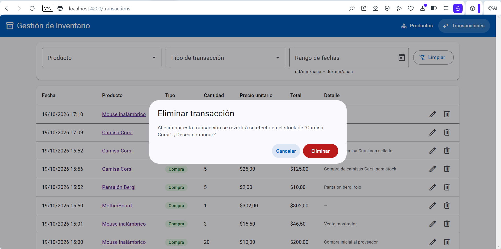

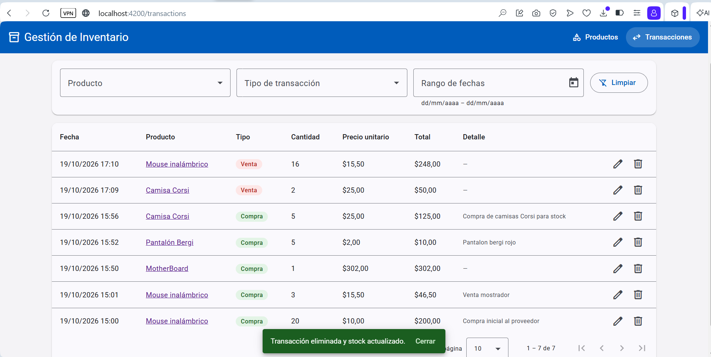

### Eliminación de productos
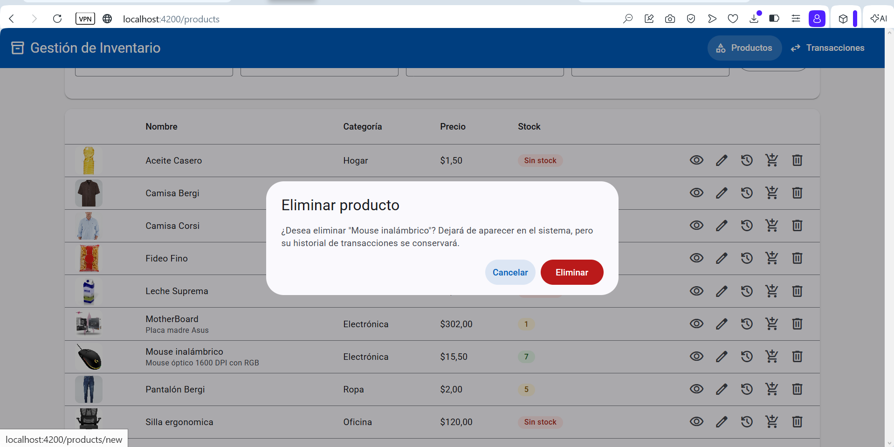

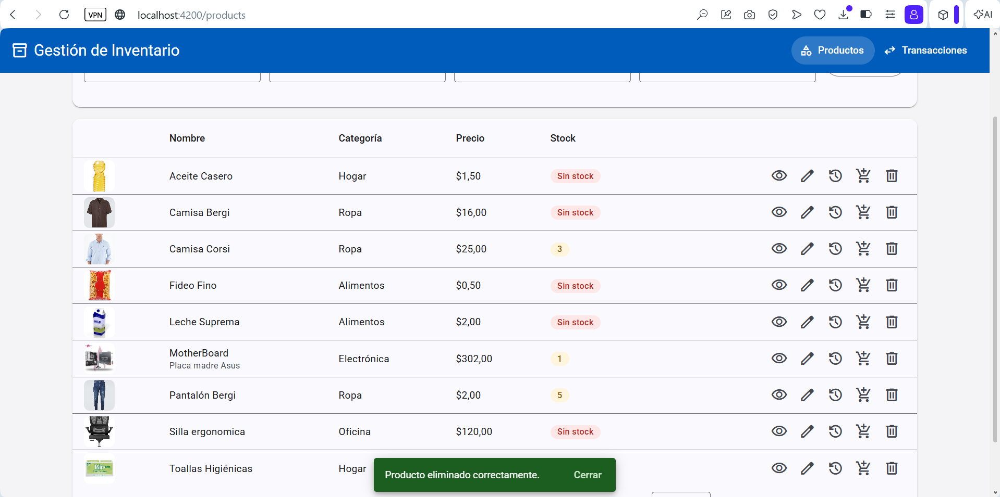
